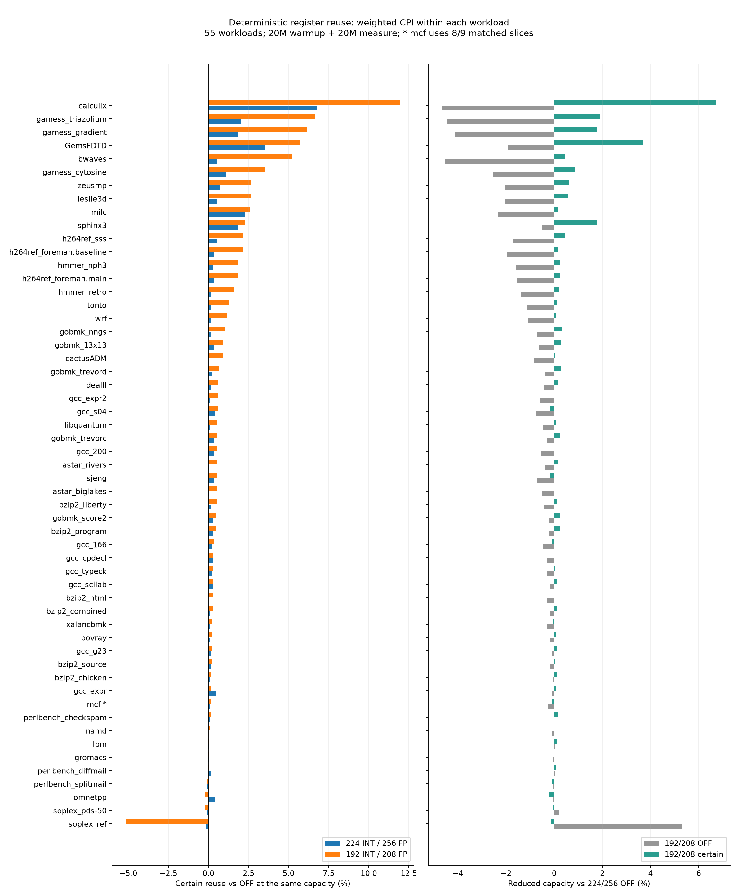
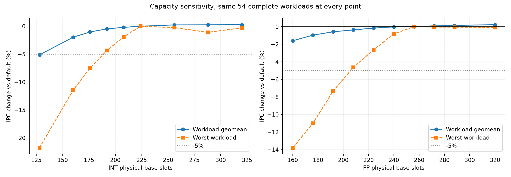
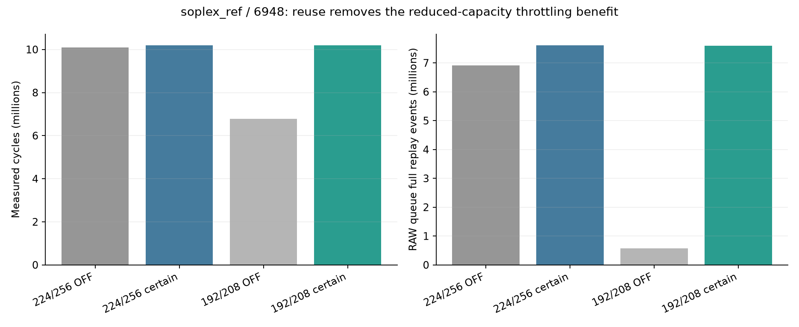

# XS-GEM5 寄存器复用大规模实验分析（2026-11-02）

本轮结果支持的判断是：**确定性复用能在缩减基础物理寄存器槽位后补回性能；默认容量下的总体性能空间较小，当前结果尚不能证明面积或能耗收益。** 需要优先解释 soplex_ref 的下游队列效应，再用有限 shadow 容量检验收益的硬件成本。

**实验身份与完成情况**

计划 `e37c5c85366b7d9e`，55 个 workload/input，584 个 SimPoint 切片，20M 预热 + 20M 测量；每个 workload 原计划覆盖至少 80% 权重。容量扫描有 20 个配置；复用实验是 224/256、192/208 两种容量下的 OFF/certain 配对。两组实验分别使用固定的观察器二进制和 feature 二进制，性能收益始终在同一 feature 二进制内配对。

14,016 个任务已经结束，按运行记录有 14,007 个正常完成；其余 9 个均为 mcf/12253 的 7,200 秒墙钟超时：容量实验 7 个，192/208 OFF/certain 2 个。日志未显示 difftest 失败，超时任务也不能算通过验证。容量有效运行数为 11,673；复用有效运行数为 2,334。

进一步交叉检查了容量观察器二进制与 feature-OFF：默认容量的 584 个、缩容的 583 个可配对运行，测量指令数和周期数全部完全一致。这将原来 8 个短切片的关闭开关等价性证据扩展到了本轮全部可配对切片。

mcf/12253 权重为 0.137576：mcf 的缩容复用比较只有 8/9 个配对切片，覆盖权重由原计划 0.8410435 降至 0.7034675。其他 54 个 workload 配对完整。因此以下同时区分 55 个可用 workload 与 54 个完整 workload；“完整”均指完成原计划的所选切片，不是覆盖整个程序的全部阶段。

workload 内按 SimPoint 权重加权 CPI，再求性能比；跨 workload 使用等权几何平均。55 个 workload 含同一 benchmark 的不同输入，不能作为官方 SPEC2006 分数。早期 8 个单片、1M 测量的结果属于另一组样本和窗口，不能与本轮长测混用。作为输入权重敏感性检查，先在同名 benchmark 的输入间等权取几何平均，再对 29 个 benchmark 名称等权，默认/缩容复用收益为 +0.711%/+1.595%；这同样不是官方分数，不改变总体判断。

**确定性复用的效果**

| 比较 | 55 个可用 workload | 54 个完整 workload |
|---|---:|---:|
| 224/256 certain / 同容量 OFF | +0.528% | +0.535% |
| 192/208 certain / 同容量 OFF | +1.235% | +1.256% |
| 192/208 OFF / 224/256 OFF（四组共同切片） | -0.830% | -0.841% |
| 192/208 certain / 224/256 OFF（四组共同切片） | +0.395% | +0.404% |

默认容量的同容量比较覆盖全部 584 个切片；四组共同切片比较有 583 个。缩容后开启复用，54 个完整 workload 全部保留默认性能的 99% 以上；可用但不完整的 mcf 也在这个范围内。缩容 OFF 相对默认有 16 个 workload 损失超过 1%，开启后没有超过 1% 的 workload。这里的 1% 是工程评价界限，没有重复运行得到的统计置信区间。

| Workload | 默认 certain / OFF | 缩容 certain / OFF | 缩容 OFF / 默认 OFF | 缩容 certain / 默认 OFF |
|---|---:|---:|---:|---:|
| calculix | +6.753% | +11.955% | -4.664% | +6.733% |
| GemsFDTD | +3.502% | +5.747% | -1.937% | +3.699% |
| gamess_triazolium | +2.011% | +6.632% | -4.429% | +1.909% |
| gamess_gradient | +1.810% | +6.139% | -4.114% | +1.773% |
| bwaves | +0.535% | +5.209% | -4.536% | +0.436% |
| leslie3d | +0.560% | +2.673% | -2.025% | +0.594% |
| milc | +2.307% | +2.583% | -2.349% | +0.173% |
| gcc_166 | +0.226% | +0.377% | -0.452% | -0.077% |
| soplex_ref | -0.138% | -5.166% | +5.292% | -0.147% |

默认容量下没有 workload 总体退化超过 1%，但只有 7 个 workload 的收益超过 1%；192/208 下有 18 个超过 1%，且 soplex_ref 是唯一总体退化超过 1% 的 workload。收益有明显集中性，不能用“复用次数多”推导对所有应用有效。workload 汇总还会掩盖阶段差异：默认容量有 5/584 个切片退化超过 1%，没有超过 5%；缩容有 11/583 个超过 1%，其中超过 5% 的 5 个全部属于 soplex_ref。



**容量扫描给出的基线空间**

| 容量变化（OFF） | workload 几何平均变化 | 最差 workload | 损失超过 5% 的 workload |
|---|---:|---|---:|
| INT=160、FP=256 | -1.965% | gamess_triazolium：-11.45% | 7/54 |
| INT=176、FP=256 | -1.020% | gamess_triazolium：-7.48% | 2/54 |
| INT=192、FP=256 | -0.476% | gamess_triazolium：-4.35% | 0/55 |
| INT=224、FP=192 | -0.576% | bwaves：-7.33% | 2/54 |
| INT=224、FP=208 | -0.361% | calculix：-4.63% | 0/55 |
| INT=192、FP=208 | -0.832% | calculix：-4.66% | 0/55 |
| INT=512、FP=512 | +0.546% | soplex_ref：-0.13% | 0/55 |

含 mcf 缺失任务的容量点只纳入 54 个完整 workload；附图固定使用所有容量点都完整的同一组 54 个 workload，避免曲线的样本集合变化。容量扫描 192/208 OFF 的 -0.832% 与 feature 二进制四组共同切片的 -0.830% 差异来自 mcf 的切片集合。

在当前所选切片上，**192/208 关闭复用时本身已经满足所有 workload 损失不超过 5%**。所以“缩减到 192/208 后只损失不到 5%”不能单独用于证明 feature 的贡献。复用的增量价值在于进一步补回损失，使完整 workload 均进入 1% 性能保留范围。

INT=176 和 FP=192 已出现明显越过 5% 界限的应用，适合作为下一轮缩容评估点；两类容量同时下降需要重新跑配对，不能把独立扫描的结果直接相乘。1% 阈值还受非单调反馈影响，例如某些点加大容量反而变慢；阈值 CSV 中要求“该点及所有更大已测点”均满足约束，含义比单点满足更严格。

默认容量 certain 的 +0.528% 已接近大容量参照的 +0.546%。这表明当前模型中，单靠缓解 PRF 容量压力获得大幅总体 IPC 提升的空间有限。512/512 是实验参照，不是对任何机制严格成立的性能上界。



**瓶颈类别与机会统计**

默认容量下，49/55 个 workload 的独立容量阻塞占比至少为 1%，6/55 至少为 10%。这是 schema-2 对有等待指令的 `canRename()` 失败检查，不是早期漏计的 RegFull 根因计数。

独立容量阻塞很高也不意味着能回收对应比例的执行时间。bwaves 的该占比约 29.36%，增至 512/512 的实际收益仅 +0.535%；calculix 约 43.56%，大容量收益约 +6.73%。阻塞与长延迟、其他资源和反馈路径存在重合，应以配对 CPI 为性能结论。

单类容量扫描可以定位资源侧：calculix 增 INT 到 320 几乎无收益，增 FP 到 320 约 +4.99%；gamess_gradient 和 gamess_triazolium 增 INT 到 320 分别约 +1.80%、+2.00%，增加 FP 几乎无收益；GemsFDTD 的 INT/FP 两侧都影响性能。不能因为程序属于浮点应用，就认定收益来自浮点寄存器复用。

生命周期数据支持“存在机会”，但机会与可实现收益仍有距离。例如 calculix 的 FP 单消费者比例约 92.0%，其中同架构寄存器重定义约占 70.4%；bwaves 的 FP 单消费者比例约 97.2%，同架构重定义约占 37.0%。当前 certain 模式只覆盖满足实现限制的首次消费者同架构重定义，并排除 move alias、访存/控制/微操作等覆盖者。单消费者总体比例不能直接作为 feature 覆盖率。

长测关闭了详细区间 trace，只保留累计曝光量。因此可以统计不足时平均有多少个读后仍占位的值，不能从寄存器周期曝光量推导“至少一个候选存在的停顿周期比例”。完整生命周期样本还存在窗口截断，且排除了有 alias 的值。

**soplex_ref 的退化：容量节流与 RAW queue**

soplex_ref 的 -5.166% 是相对 192/208 OFF 的退化；相对默认 OFF 仅 -0.147%。缩容 OFF 原本获得 +5.292%，开启复用后主要失去了缩容带来的好处。

最明显的切片 6948，每组测量约 20M 条指令：

| 配置 | 测量周期 | RAWQueueFullCycles | RAWQueueReplay |
|---|---:|---:|---:|
| 224/256 OFF | 10,098,046 | 4,991,045 | 6,906,931 |
| 224/256 certain | 10,200,491 | 4,990,355 | 7,615,959 |
| 192/208 OFF | 6,773,694 | 468,694 | 572,070 |
| 192/208 certain | 10,193,544 | 4,996,370 | 7,588,440 |

192/208 certain 在这个切片相对同容量 OFF 退化 33.55%。7022、14593、3823、5925 等切片也出现同方向变化。6948 的分支冲刷次数在缩容 OFF/certain 间约为 35,389/35,810，远没有 RAW queue replay 的变化大；certain 的预测修正次数和修正等待均为零。

这些数据支持的解释是：缩容提供了有利的节流，降低 RAW queue 压力；复用缓解 PRF 约束后，运行行为回到大窗口下的高重放状态。现有计数还不能独立量化每种反馈的因果贡献，应对 RAW queue 容量或分配节流做受控 A/B。不能把它归为跨寄存器预测失败，也不能把恢复组数乘延迟直接解释为额外执行时间。



**硬件含义与后续优先级**

基础槽位由 224+256=480 减至 192+208=400，减少 16.67%（INT 减少 14.29%，FP 减少 18.75%）。但本轮每个槽位有三份 shadow，模型为缩容配置保存 400×4=1,600 份标量数据版本，相对默认 OFF 的 480 份为 3.33 倍。**这是保存的数据位/版本数量对比，不是面积倍数**：shadow cell 与多端口主寄存器单元成本不同。当前实现没有异构 bank、逐端口拷贝争用、真实访问延迟或频率模型，不能据此声称面积节省 16.67%。实验固定单线程、ROB=352 且关闭压缩，性能结论也限于这个模拟配置。

`reuse_counter_rates.csv` 中每千条指令的计数，以测量段提交指令归一化动态 rename 事件，包含随后被冲刷的复用；`sharedVersions/(sharedVersions+allocatedSlots)` 也不能解释为已提交指令中的复用比例。

本轮只评估 `regReusePrediction=False`。早期 predicted 模式在 libquantum 的退化来自小样本实验，不能扩展成它在本轮 55 个 workload 上的结果，也没有证据表明需要立即为全套样本重跑该预测器。

建议按以下顺序推进：

1. 以更低并发、更长超时补齐 mcf/12253 的 9 个任务，保持二进制和 20M+20M 指令窗口不变；先消除 mcf 的配对覆盖缺口。
2. 选择 calculix、GemsFDTD、gamess、bwaves、soplex_ref 的有代表性切片，比较 1/2/3 shadow、INT/FP 分别开启，并补充实际容量阻塞、恢复阻塞周期及每类复用计数。当前 feature 禁止与旧观察器同时开启，需要为 feature 单独设计观测。
3. 在 soplex_ref 上改变 RAW queue 容量或 rename 节流，检查复用收益是否随下游压力消失而恢复。这有助于区分固有开销和窗口反馈。
4. 在 INT=176、FP=192 附近进一步做同容量 OFF/certain 及相对默认 OFF 的比较，并引入有限、异构 shadow bank。重点回答“以多少附加存储、端口和恢复代价，能减少多少主 PRF 槽位并保留性能”。

本次分析未修改模拟器实现、二进制或原始运行数据，也未启动新的模拟。重新生成了批次汇总，并新增可复算的分析脚本和派生数据。

原始汇总与配置校验见 [批次报告](../report.md)、[validation.json](../validation.json)；派生汇总见 [summary.json](summary.json)，逐 workload 四组对照见 [four_way_comparison.csv](four_way_comparison.csv)，复用计数见 [reuse_counter_rates.csv](reuse_counter_rates.csv)，机会统计见 [baseline_opportunities.csv](baseline_opportunities.csv)，退化案例原始计数见 [soplex_raw_queue_case.csv](soplex_raw_queue_case.csv)。

复算命令（第一步只校验和读取已有模拟产物）：

```bash
python3 register_reuse_distributed/experiment.py report \
  --plan register_reuse_distributed/batch-6servers/plan.json
# 仍有超时任务时，report 退出码为 1，同时写出有效结果和失败清单。
register_reuse_analysis/.venv-plot/bin/python \
  register_reuse_distributed/analyze_results.py --plot
```
